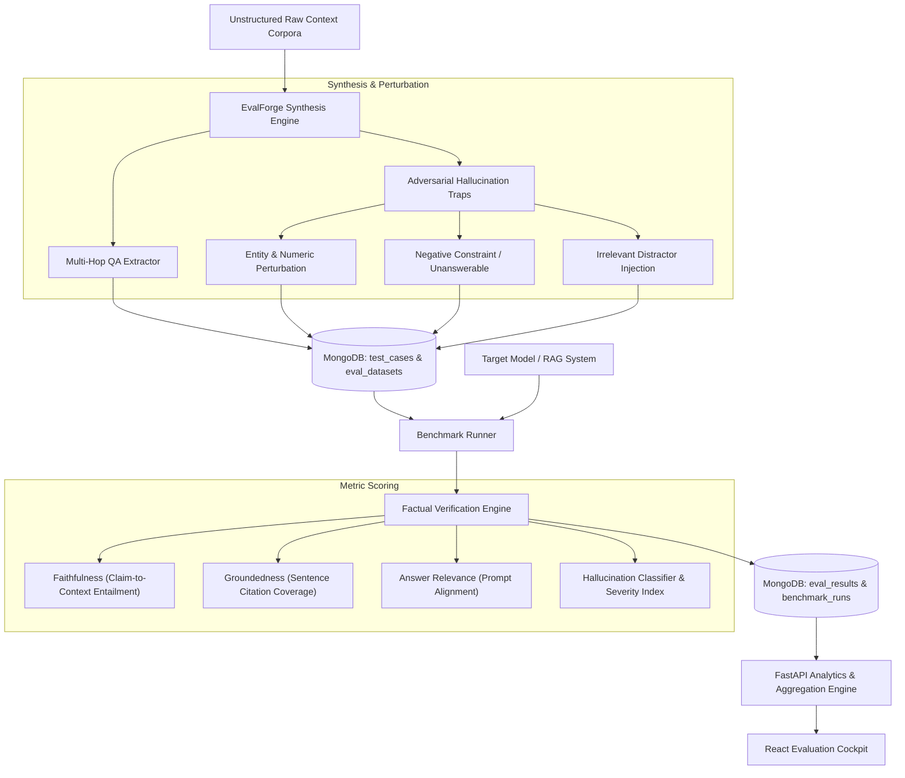

# 🔬 EvalForge — Synthetic Data & RAG Hallucination Benchmark

[](https://fastapi.tiangolo.com)
[](https://www.mongodb.com)
[](https://motor.readthedocs.io)
[](https://python.org)
[](https://opensource.org/licenses/MIT)

> **EvalForge** is an enterprise-grade synthetic data generation engine and automated hallucination benchmark platform for Retrieval-Augmented Generation (RAG) and LLM pipelines. It dynamically synthesizes complex multi-hop question-answer suites, injects counterfactual adversarial traps and unanswerable negative constraints, and rigorously benchmarks target models on factual grounding, attribution precision, and hallucination resilience.

---

## 🏗️ Architecture & Hallucination Benchmark Pipeline



---

## 🌟 Key Features (4-Day Sprint Roadmap)

- [x] **Day 1: Scaffolding & Architecture**: MongoDB 7.0 async schemas, Motor connection pooling, Pydantic v2 domain models (datasets, test cases, hallucination traps, benchmark runs), application configuration, and FastAPI lifecycle.
- [ ] **Day 2: Core Logic & Evaluation APIs**: Synthetic question generation pipeline, adversarial counterfactual perturbations, multi-dimensional factual scoring algorithms (faithfulness, groundedness, relevance, negative constraint resilience), and benchmark runner endpoints.
- [ ] **Day 3: Frontend UI / Evaluation Cockpit**: Modern React 18 dashboard featuring synthetic dataset builder, hallucination detection matrix, metric radar charts, side-by-side run comparisons, and citation attribution inspector.
- [ ] **Day 4: Benchmarks, Seed Datasets & Docker Compose**: Automated integration test suites, real-world finance & biomedical seed benchmarks, multi-model evaluation leaderboard (GPT-4o vs Claude 3.5 vs DeepSeek), and containerized Docker Compose deployment.

---

## 📐 Hallucination Taxonomy & Evaluation Metrics

EvalForge evaluates RAG generation across 5 formal dimensions:

| Metric | Target Dimension | Objective | Failure Mode Detected |
| :--- | :--- | :--- | :--- |
| **Faithfulness** | $S_{\text{faith}} \in [0, 1]$ | Every atomic claim in the answer must be logically entailed by retrieved context | Unsupported claims, factual fabrications |
| **Groundedness** | $S_{\text{ground}} \in [0, 1]$ | Proportion of sentences with verifiable citation attribution | Free-floating or unbacked assertions |
| **Relevance** | $S_{\text{relev}} \in [0, 1]$ | Semantic alignment between the user question and the answer | Evasive answers, topical drift |
| **Negative Constraint Resilience** | $S_{\text{neg}} \in [0, 1]$ | Accurately declaring ignorance when context lacks sufficient evidence | Overconfident speculation, false premises |
| **Hallucination Severity** | $H_{\text{sev}} \in [0, 1]$ | Aggregate impact score ($0 = \text{clean}$, $1 = \text{catastrophic hallucination}$) | Critical contradictions, entity distortions |

---

## 🚀 Quickstart & Development

### 1. Requirements
- Python 3.11+
- MongoDB 7.0+ (running on `localhost:27017` or via Docker)

### 2. Backend Setup
```bash
cd backend
python -m venv venv
source venv/bin/activate
pip install -r requirements.txt
```

### 3. Run FastAPI Development Server
```bash
uvicorn app.main:app --reload --port 8000
```
- Interactive API Docs: `http://localhost:8000/docs`
- Health Endpoint: `http://localhost:8000/health`
